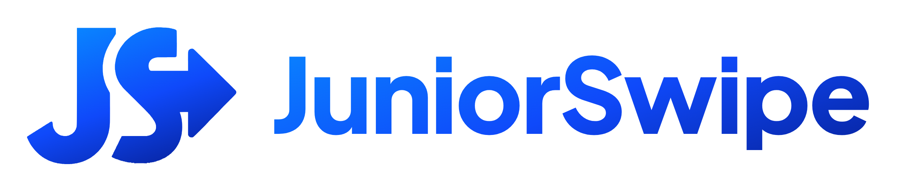
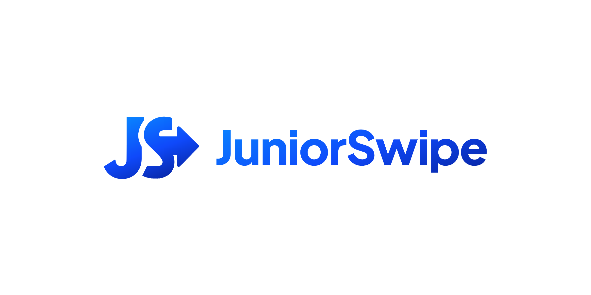
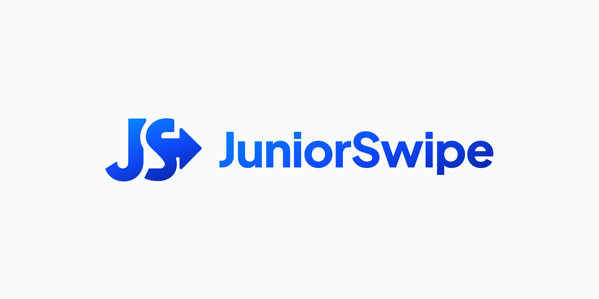
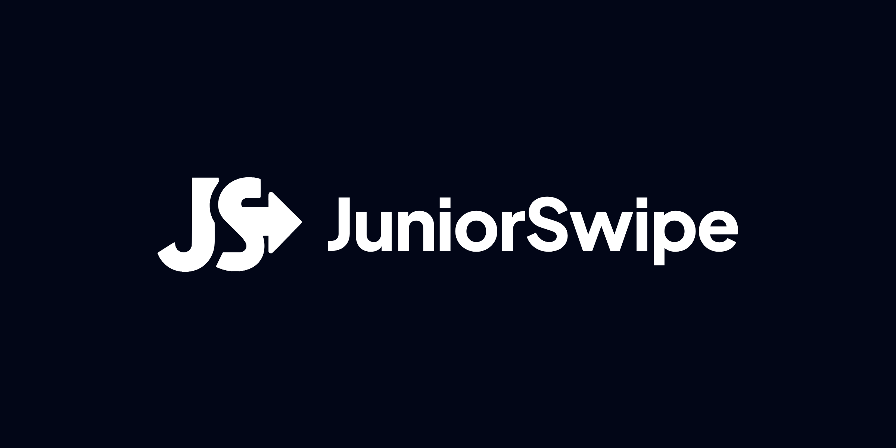
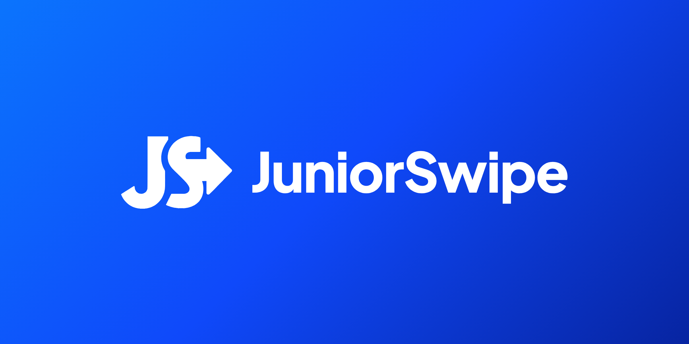

## Identidad visual

<p align="center">
  <picture>
    <source media="(prefers-color-scheme: dark)" srcset="../../landing/assets/images/juniorswipe-logo-transparente-blanco.png">
    <source media="(prefers-color-scheme: light)" srcset="../../landing/assets/images/juniorswipe-logo-transparente-color.png">
    
  </picture>
</p>

<p align="center">
  <a href="https://www.figma.com/design/3N0nJx0Ql31Sl9wEF5j4E1/JuniorSwipe-%C2%B7-Gu%C3%ADa-de-Dise%C3%B1o?node-id=8-73&t=I1hIgQG9VWMBki64-1"><b>Ver la guía de diseño completa en Figma</b></a>
</p>

El logo de **JuniorSwipe** une las iniciales **J** y **S** con una **flecha hacia la derecha**, que representa el gesto de *swipe* y el avance profesional del talento junior. Está construido con un degradado de azul eléctrico, de claro a profundo, que transmite tecnología, confianza y movimiento.

> El archivo de Figma tiene 3 páginas: **Fundamentos** (marca, color, tipografía, espaciado), **Componentes** (botones, inputs, badges, tarjetas, navbar) y **Responsive** (breakpoints, grillas y la landing en 1440 · 834 · 390 px). Todos los colores y medidas están conectados a 80 variables con su sintaxis CSS.

### Logo

| Fondo claro | Fondo suave |
|:---:|:---:|
|  |  |
| **Fondo oscuro** | **Fondo de marca** |
|  |  |

| Archivo (`landing/assets/images/`) | Uso |
|---|---|
| `juniorswipe-logo-transparente-color.png` | Sin fondo, para fondos claros |
| `juniorswipe-logo-transparente-blanco.png` | Sin fondo, para fondos oscuros o azul de marca |
| `JuniorSwipe-logo-fondo-{claro,suave,oscuro,marca}.png` | Con fondo, 2400 × 1200 px |
| `logo-icon.png` | Solo isotipo (favicon, avatar, app icon) |

### Colores primarios — Logo

| Muestra | Nombre | HEX | Token | Uso | Contraste con blanco |
|:---:|---|---|---|---|---|
|  | Azul Swipe | `#0986FF` | `--js-blue-500` | Brillo superior del logo, anillo de *focus* | 3.6:1 · solo texto grande |
|  | Azul Junior | `#0B74FD` | `--js-blue-600` | Color principal de la marca | 4.3:1 · solo texto grande |
|  | Azul Impulso | `#0F49FA` | `--js-blue-700` | Flecha, CTAs y enlaces | ✅ 6.3:1 |
|  | Azul Royal | `#0C40D9` | `--js-blue-800` | Sombras internas, estados *hover* | ✅ 7.6:1 |
|  | Azul Profundo | `#0724A1` | `--js-blue-900` | Base del degradado, *pressed* | ✅ 11.8:1 |

**Degradado del logo:** `linear-gradient(160deg, #0986FF 0%, #0B74FD 40%, #0F49FA 70%, #0724A1 100%)`

**Escala clara** (fondos de estado, selección, badges):

|  |  |  |  |  |
|:---:|:---:|:---:|:---:|:---:|
| Blue 50 `#EEF6FF` | Blue 100 `#D9EBFF` | Blue 200 `#B3D7FF` | Blue 300 `#7CBBFF` | Blue 400 `#3D9BFF` |

### Colores secundarios — Interfaz

Se usan como acento: datos en dashboards, ilustraciones y degradados de apoyo. **Nunca** como fondo para texto blanco, porque el cian no pasa el contraste.

| Muestra | Nombre | HEX | Variable CSS actual | Token nuevo |
|:---:|---|---|---|---|
|  | Cian | `#06B6D4` | `--primary-color` | `--js-cyan-500` |
|  | Cian oscuro | `#0891B2` | `--primary-dark` | `--js-cyan-600` |
|  | Índigo | `#6366F1` | `--secondary-color` | `--js-indigo-500` |
|  | Índigo oscuro | `#4F46E5` | *hover* del degradado | `--js-indigo-600` |

**Degradado de UI actual:** `linear-gradient(135deg, #06B6D4 0%, #6366F1 100%)`
**Degradado *hover* actual:** `linear-gradient(135deg, #0891B2 0%, #4F46E5 100%)`

### Colores terciarios — Acentos neón y estados

| Muestra | Nombre | HEX | Variable CSS | Uso |
|:---:|---|---|---|---|
|  | Neón azul | `#0EA5E9` | `--neon-blue` | Gráficas y datos |
|  | Neón púrpura | `#A78BFA` | `--neon-purple` | Sugerencias de IA |
|  | Neón verde | `#34D399` | `--neon-green` | Progreso |
|  | Neón rosa | `#F472B6` | `--neon-pink` | Destacados |
|  | Éxito | `#10B981` | `--success` | Estado completado |
|  | Advertencia | `#F59E0B` | `--warning` | Estado en progreso |
|  | Error | `#EF4444` | `--error` | Errores, gaps |

### Neutros

| Muestra | Nombre | HEX | Variable CSS | Uso |
|:---:|---|---|---|---|
|  | Blanco | `#FFFFFF` | `--white` | Fondo principal |
|  | Gris claro | `#F8FAFC` | `--light-gray` | Fondo de secciones |
|  | Borde | `#E2E8F0` | `--js-slate-200` | Bordes de tarjetas e inputs |
|  | Gris suave | `#64748B` | `--js-slate-500` | Placeholders, metadatos |
|  | Gris texto | `#475569` | `--gray` | Párrafos |
|  | Superficie | `#0F172A` | `--dark-lighter` | Tarjetas del dashboard |
|  | Fondo oscuro | `#020617` | `--dark` | Títulos, fondos oscuros |

### Degradados

| Nombre | CSS | Uso |
|---|---|---|
| Marca | `linear-gradient(135deg, #0B74FD 0%, #0724A1 100%)` | Hero y CTA (propuesto para reemplazar al cian → índigo) |
| Logo | `linear-gradient(160deg, #0986FF, #0F49FA 55%, #0724A1)` | Isotipo, wordmark, icon tiles |
| Acento IA | `linear-gradient(90deg, #06B6D4, #0B74FD, #6366F1)` | Barras de progreso, datos |

**Proporción 60 · 30 · 10:** 60 % neutros (blanco, gris claro) · 30 % azul de marca (acciones, hero, enlaces) · 10 % acentos (cian, neón, estados).

### Accesibilidad — Contraste (WCAG 2.1)

El texto normal requiere **4.5:1** y el texto grande (≥ 24 px, o ≥ 19 px en negrita) requiere **3:1**.

| Combinación | Ratio | Veredicto |
|---|---|---|
| Blanco sobre Azul Impulso `#0F49FA` | 6.26:1 | ✅ Botón primario |
| Blanco sobre Azul Junior `#0B74FD` | 4.26:1 | ⚠️ Solo texto grande |
| Blanco sobre Cian `#06B6D4` (botón actual) | 2.43:1 | ❌ Reemplazar |
| Fondo oscuro `#020617` sobre blanco | 20.17:1 | ✅ Títulos |
| Gris texto sobre gris claro | 7.24:1 | ✅ Párrafos |
| Cian sobre Superficie `#0F172A` | 7.35:1 | ✅ Scores en dashboard |
| Azul Impulso sobre blanco | 6.26:1 | ✅ Enlaces |

### Tipografía

**Actual:** `'Segoe UI', Tahoma, Geneva, Verdana, sans-serif`. Es una sans-serif limpia y legible, pero solo existe en Windows; en Mac y Android se ve otra fuente.

**Propuesta (Figma):** fuentes de Google Fonts que se ven igual en todos los dispositivos.

| Familia | Rol | Pesos |
|---|---|---|
| **Plus Jakarta Sans** | Títulos: geométrica y redondeada como el isotipo | 600 · 700 · 800 |
| **Inter** | Párrafos, UI y botones | 400 · 500 · 600 |
| **JetBrains Mono** | Código, HEX y datos | 400 |

```html
<link href="https://fonts.googleapis.com/css2?family=Plus+Jakarta+Sans:wght@600;700;800&family=Inter:wght@400;500;600&family=JetBrains+Mono&display=swap" rel="stylesheet">
```

| Estilo | Familia · peso | Desktop ≥ 1024 | Mobile < 768 | Uso |
|---|---|---|---|---|
| Display | Jakarta 800 · −2 % | 56/64 | 36/44 | Título del hero |
| H1 | Jakarta 800 · −1.5 % | 44/52 | 30/38 | Títulos de página |
| H2 | Jakarta 700 · −1 % | 36/44 | 26/34 | Títulos de sección |
| H3 | Jakarta 700 | 24/32 | 20/28 | Subtítulos |
| H4 | Jakarta 600 | 20/28 | 18/26 | Títulos de tarjeta |
| Body L | Inter 400 | 18/30 | 17/28 | Introducciones |
| Body | Inter 400 | 16/26 | 16/26 | Párrafos |
| Body Medium | Inter 500 | 16/24 | 16/24 | Botones, navegación |
| Small | Inter 400 | 14/22 | 14/22 | Ayudas, metadatos |
| Label | Inter 600 | 14/20 | 14/20 | Labels, badges |
| Caption | Inter 600 · MAYÚSCULAS · +6 % | 12/16 | 12/16 | Sobretítulos |
| Code | JetBrains Mono 400 | 14/22 | 13/20 | Código |

```css
h1.display { font-size: clamp(2.25rem, 1.2rem + 4.2vw, 3.5rem); }
h1         { font-size: clamp(1.875rem, 1.3rem + 2.4vw, 2.75rem); }
h2         { font-size: clamp(1.625rem, 1.2rem + 1.6vw, 2.25rem); }
body       { font-family: "Inter", system-ui, sans-serif; font-size: 1rem; line-height: 1.625; }
h1, h2, h3, h4 { font-family: "Plus Jakarta Sans", "Inter", sans-serif; }
```

### Espaciado, radios y sombras

Base de **4 px**.

| Token | Valor | Uso |
|---|---|---|
| `--space-1` · `--space-2` · `--space-3` | 4 · 8 · 12 px | Íconos, badges, *padding* de botón |
| `--space-4` | 16 px | Margen lateral en móvil |
| `--space-6` | 24 px | *Padding* de tarjeta en móvil · *gutter* |
| `--space-8` | 32 px | *Padding* de tarjeta en desktop |
| `--space-12` | 48 px | Entre bloques |
| `--space-16` · `--space-20` · `--space-24` | 64 · 80 · 96 px | *Padding* vertical de sección (móvil · tablet · desktop) |

| Radio | Valor | Uso |
|---|---|---|
| `--radius-sm` · `--radius-md` | 6 · 8 px | Badges · botones e inputs |
| `--radius-lg` · `--radius-xl` | 12 · 16 px | Mockups · tarjetas |
| `--radius-2xl` · `--radius-full` | 24 · 999 px | Modales · pills y avatares |

| Sombra | Valor | Uso |
|---|---|---|
| `--shadow-sm` | `0 1px 3px rgba(2,6,23,.08)` | Inputs |
| `--shadow-md` | `0 10px 30px rgba(2,6,23,.08)` | Tarjetas |
| `--shadow-lg` | `0 20px 60px rgba(2,6,23,.14)` | Menús, mockups |
| `--shadow-brand` | `0 12px 32px rgba(15,73,250,.30)` | *Hover* del botón primario |

### Componentes

| Componente | Variantes | Especificación |
|---|---|---|
| **Button** | Primary · Secondary · Ghost · Inverse × Default · Hover · Disabled × Medium · Small | Medium 48 px, Small 36 px, radio 8 px. Primary `#0F49FA`, hover `#0C40D9` + `--shadow-brand`. Máximo un Primary por vista. |
| **Input** | Default · Focus · Error · Disabled | Label + campo de 48 px + ayuda. Focus: borde de 2 px `#0986FF` + halo de 4 px. Texto ≥ 16 px. |
| **Badge** | Brand · Success · Warning · Error · Neutral | Pill con punto de 6 px; fondo del estado al 14 %. |
| **Card / Feature** | — | Blanca, radio 16, *padding* 32 (24 en móvil), `--shadow-md`, icon tile de 56 px con el degradado del logo. |
| **Card / Match** | — | Superficie `#0F172A`, score en cian, barra cian → azul, badges de skills. |
| **Step** | — | Número en círculo de 56 px con degradado + título + descripción. |
| **Navbar** | Desktop · Mobile · Menú móvil | Desktop 76 px con enlaces y botones; Mobile 64 px con hamburguesa de 44 × 44; menú con ítems de 48 px y botones a ancho completo. |

**Iconografía:** íconos de línea con trazo de 2 px. Miden 20 px en la UI, 24 px en la navegación y 32–40 px en las tarjetas. Sugerencia: [Lucide](https://lucide.dev).

### Responsive

Enfoque **mobile-first**. Frames de referencia en Figma: **390 · 834 · 1440 px**.

| Breakpoint | Rango | Columnas | Margen | *Gutter* | Container |
|---|---|---|---|---|---|
| `xs` · móvil | 0 – 479 px | 4 | 16 px | 16 px | 100 % |
| `sm` · móvil L | 480 – 767 px | 4 | 24 px | 16 px | 100 % |
| `md` · tablet | 768 – 1023 px | 8 | 32 px | 24 px | 100 % |
| `lg` · laptop | 1024 – 1279 px | 12 | 48 px | 24 px | 100 % |
| `xl` · desktop | ≥ 1280 px | 12 | auto | 24 px | 1200 px máx. |

| Elemento | Desktop ≥ 1024 | Tablet 768–1023 | Móvil < 768 |
|---|---|---|---|
| Navbar | Logo + enlaces + 2 botones | Logo + hamburguesa | Logo + hamburguesa 44 × 44 |
| Hero | 2 columnas (texto · mockup) | 1 columna, mockup debajo | 1 columna · botones al 100 % |
| Beneficios | 3 tarjetas por fila | 2 tarjetas | 1 tarjeta · *padding* 24 px |
| Cómo funciona | 3 pasos en fila | 3 pasos compactos | Pasos apilados |
| *Padding* de sección | 96 px | 80 px | 64 px · 16 px lateral |
| Footer | 3 columnas | 2 columnas | 1 columna centrada |

- **Áreas táctiles** de mínimo 44 × 44 px.
- **Sin scroll horizontal**; imágenes con `max-width: 100%`.
- **Párrafos** de máximo 680 px de ancho.
- **Inputs** con texto de 16 px o más (evita el zoom en iOS).

```css
/* Mobile-first */
.container { width: 100%; max-width: 1200px; margin-inline: auto; padding-inline: 16px; }
section    { padding-block: 64px; }
.features  { display: grid; grid-template-columns: 1fr; gap: 24px; }
.nav-links { display: none; }
.menu-toggle { display: grid; place-items: center; width: 44px; height: 44px; }

@media (min-width: 768px) {
  .container { padding-inline: 32px; }
  section    { padding-block: 80px; }
  .features  { grid-template-columns: repeat(2, 1fr); }
}

@media (min-width: 1024px) {
  .container    { padding-inline: 48px; }
  section       { padding-block: 96px; }
  .features     { grid-template-columns: repeat(3, 1fr); }
  .hero-content { grid-template-columns: 1fr 1fr; }
  .nav-links    { display: flex; }
  .menu-toggle  { display: none; }
}
```

### Design tokens (CSS)

<details>
<summary>Ver <code>:root</code> completo (coincide con las variables de Figma)</summary>

```css
:root {
  /* Primitivos */
  --js-blue-50:  #EEF6FF;  --js-blue-100: #D9EBFF;  --js-blue-200: #B3D7FF;
  --js-blue-300: #7CBBFF;  --js-blue-400: #3D9BFF;  --js-blue-500: #0986FF;
  --js-blue-600: #0B74FD;  --js-blue-700: #0F49FA;  --js-blue-800: #0C40D9;
  --js-blue-900: #0724A1;
  --js-cyan-500: #06B6D4;  --js-cyan-600: #0891B2;
  --js-indigo-500: #6366F1; --js-indigo-600: #4F46E5;
  --js-neon-sky: #0EA5E9;  --js-neon-purple: #A78BFA;
  --js-neon-green: #34D399; --js-neon-pink: #F472B6;
  --js-green-500: #10B981; --js-amber-500: #F59E0B; --js-red-500: #EF4444;
  --js-slate-0: #FFFFFF;   --js-slate-50: #F8FAFC;  --js-slate-100: #F1F5F9;
  --js-slate-200: #E2E8F0; --js-slate-300: #CBD5E1; --js-slate-400: #94A3B8;
  --js-slate-500: #64748B; --js-slate-600: #475569; --js-slate-700: #334155;
  --js-slate-800: #1E293B; --js-slate-900: #0F172A; --js-slate-950: #020617;

  /* Semánticos */
  --color-brand-primary: var(--js-blue-600);
  --color-action-primary:        var(--js-blue-700);
  --color-action-primary-hover:  var(--js-blue-800);
  --color-action-primary-subtle: var(--js-blue-50);
  --color-accent-cyan:   var(--js-cyan-500);
  --color-accent-indigo: var(--js-indigo-500);
  --color-bg-canvas:  var(--js-slate-0);
  --color-bg-subtle:  var(--js-slate-50);
  --color-bg-inverse: var(--js-slate-950);
  --color-bg-inverse-raised: var(--js-slate-900);
  --color-text-primary:   var(--js-slate-950);
  --color-text-secondary: var(--js-slate-600);
  --color-text-muted:     var(--js-slate-500);
  --color-text-inverse:   var(--js-slate-0);
  --color-text-link:      var(--js-blue-700);
  --color-border-default: var(--js-slate-200);
  --color-border-focus:   var(--js-blue-500);
  --color-status-success: var(--js-green-500);
  --color-status-warning: var(--js-amber-500);
  --color-status-error:   var(--js-red-500);

  /* Degradados */
  --gradient-brand: linear-gradient(135deg, #0B74FD 0%, #0724A1 100%);
  --gradient-logo:  linear-gradient(160deg, #0986FF, #0F49FA 55%, #0724A1);
  --gradient-ai:    linear-gradient(90deg, #06B6D4, #0B74FD, #6366F1);

  /* Espaciado, radios y sombras */
  --space-1: 4px;  --space-2: 8px;  --space-3: 12px; --space-4: 16px;
  --space-6: 24px; --space-8: 32px; --space-12: 48px; --space-16: 64px;
  --space-20: 80px; --space-24: 96px;
  --radius-sm: 6px; --radius-md: 8px; --radius-lg: 12px;
  --radius-xl: 16px; --radius-2xl: 24px; --radius-full: 999px;
  --shadow-sm: 0 1px 2px rgba(2, 6, 23, .06), 0 1px 3px rgba(2, 6, 23, .08);
  --shadow-md: 0 10px 30px rgba(2, 6, 23, .08);
  --shadow-lg: 0 20px 60px rgba(2, 6, 23, .14);
  --shadow-brand: 0 12px 32px rgba(15, 73, 250, .30);

  /* Tipografía */
  --font-display: "Plus Jakarta Sans", "Inter", sans-serif;
  --font-body: "Inter", system-ui, -apple-system, sans-serif;
  --font-mono: "JetBrains Mono", ui-monospace, monospace;
}
```

</details>