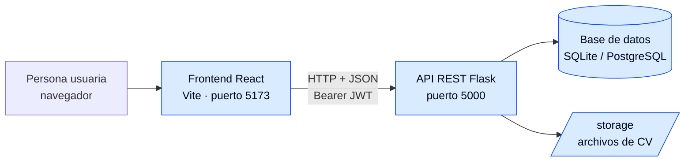
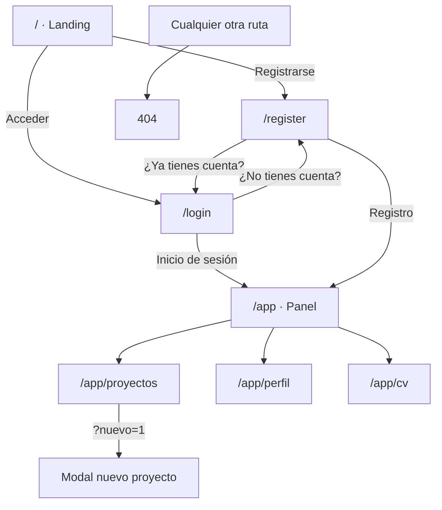
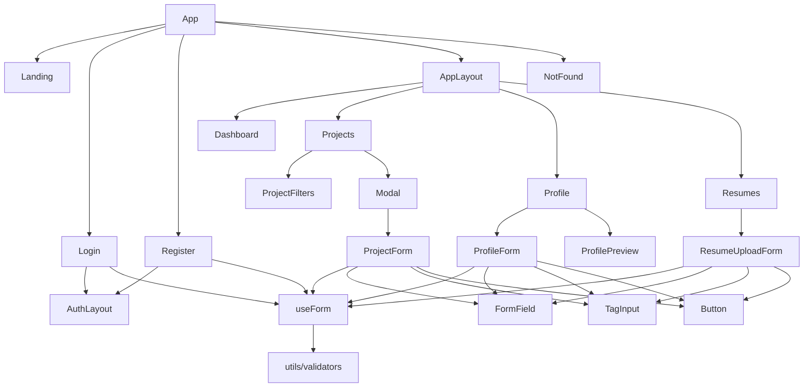
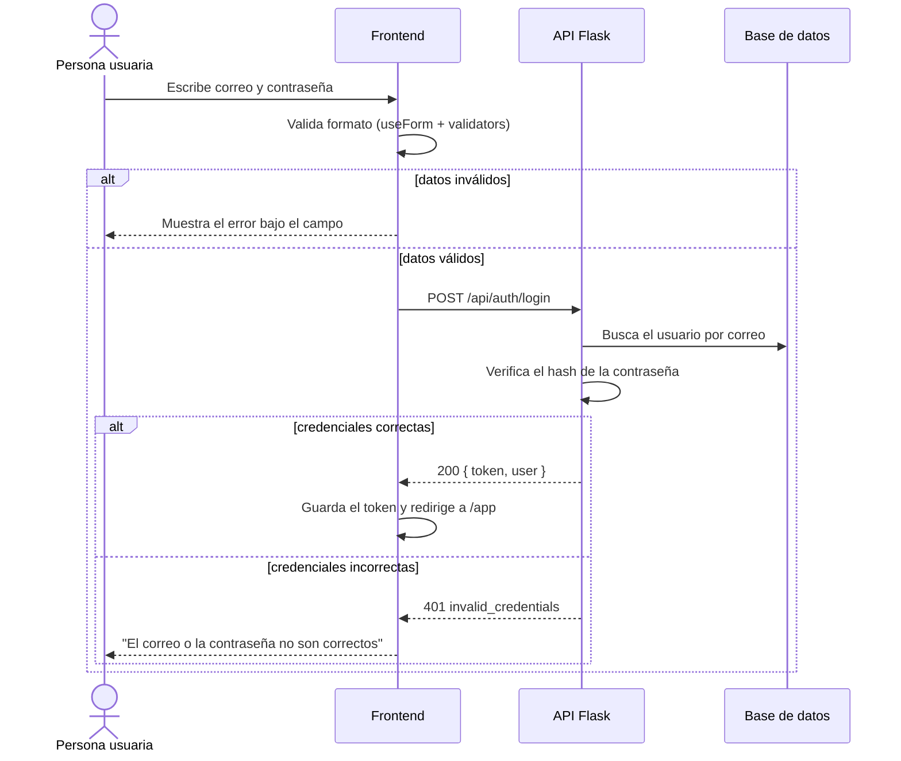

# Diagramas

Los diagramas están en Mermaid, así que GitHub los muestra como imagen directamente en esta página.

## Componentes del sistema

Todos los componentes están implementados en la Fase II. En desarrollo la base de datos es SQLite; PostgreSQL queda para el despliegue.

## Mapa de navegación

## Componentes del frontend

## Secuencia de inicio de sesión

