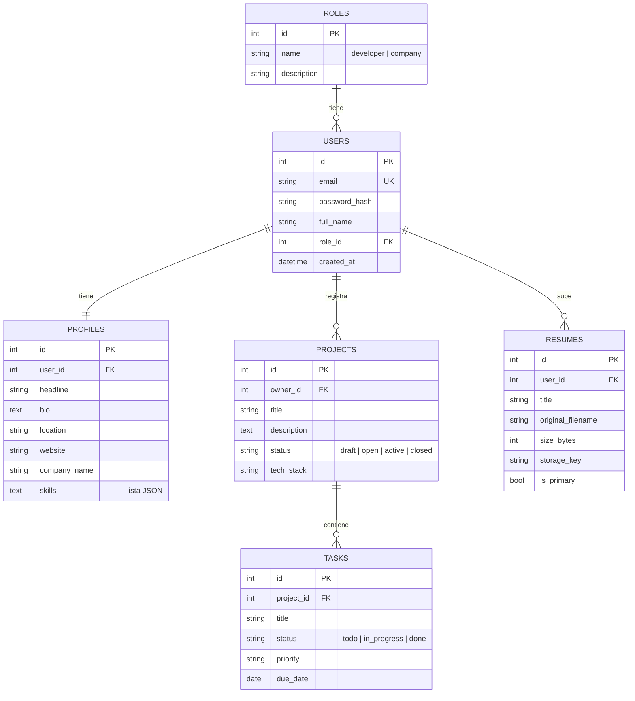

# Modelo de datos

Seis tablas. Cada proyecto, actividad, CV y perfil pertenece a un solo usuario. El esquema para PostgreSQL está en `database/schema.sql` y SQLAlchemy crea las mismas tablas en SQLite con `db.create_all()`.

| Tabla | Para qué sirve | Reglas |
|---|---|---|
| `roles` | Tipos de cuenta: `developer` (talento junior) y `company` (empresa) | Nombre único |
| `users` | Cuentas | Correo único; la contraseña se guarda con hash |
| `profiles` | Perfil público de cada cuenta | Uno por usuario; las habilidades se guardan como lista JSON |
| `projects` | Evidencias: proyectos académicos, prácticas, voluntariados | Estado: `draft`, `open`, `active` o `closed` |
| `tasks` | Actividades de cada proyecto | Estado: `todo`, `in_progress` o `done`; se borran con su proyecto |
| `resumes` | Datos de cada CV | El archivo vive en disco; solo uno puede ser el principal |
